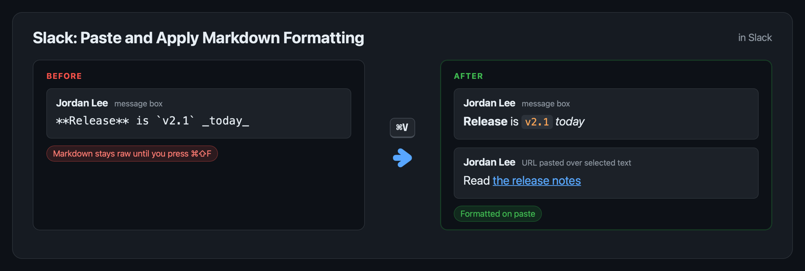
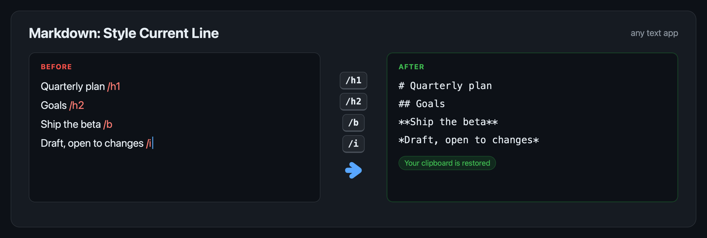
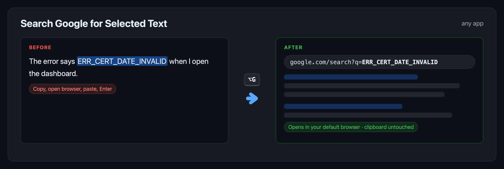
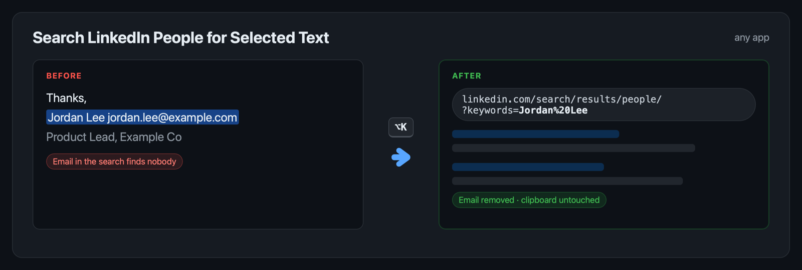

# ⌨️🪄 Keyboard Maestro Macros

> Four ready-to-import Keyboard Maestro macros for Slack, Markdown, and LinkedIn automation.

[](LICENSE.txt)
[](https://www.keyboardmaestro.com/)
[](../../pulls)

---

## ⬇️ Why Install?

- ⌨️ **One keystroke per chore** — search, format and style without leaving your app
- 📋 **Your clipboard stays yours** — every macro puts back what you had copied
- 💸 **$0 added cost** — free macros for the Keyboard Maestro you already own
- 🔍 **Nothing hidden** — every step is named and commented in the editor

| | 😩 Without these macros | 😌 With these macros |
| --- | :---: | :---: |
| 🔎 Steps to search selected text | copy, switch, new tab, paste, Enter | **⌥G** |
| 💬 Steps to send formatted Markdown in Slack | paste, then ⌘⇧F | **⌘V** |
| ✍️ Steps to turn a line into a heading | jump to line start, type `## `, jump back | **type `/h2`** |
| 📋 Clipboard after searching | overwritten | **unchanged** |

---

## ✨ Features

Each macro does one job from the app you're already in, then gets out of the way.

**💬 Slack - Paste and Apply Markdown Formatting** · ⌘V in Slack



**✍️ Markdown - Style Current Line as Heading, Bold or Italic** · type `/h1` to `/h4`, `/b` or `/i`



**🔎 Search Google for Selected Text** · ⌥G in any app



**👤 Search LinkedIn People for Selected Text** · ⌥K in any app



- 🛟 **Safe when nothing is selected** — a clear notification instead of a silent failure
- 🧹 **Search-ready text** — whitespace trimmed, URL-encoded, emails stripped for LinkedIn
- 🖥️ **Your default browser** — no browser hardcoded into any macro
- 🛑 **Stays out of terminals** — the line styler skips Terminal, iTerm, Ghostty, Warp, VS Code, Cursor and Xcode
- 🔗 **Slack links still work** — a URL pasted over selected text still becomes a link

---

## 🚀 Installation

Needs **[Keyboard Maestro](https://www.keyboardmaestro.com/)** 11 or later.

```bash
git clone <this-repo-url> Keyboard-Maestro-Macros && open Keyboard-Maestro-Macros/*.kmmacros
```

Or download any `.kmmacros` file and double-click it. Keyboard Maestro imports it enabled, triggers included.

- **Slack macro:** turn on Slack ▸ Settings ▸ Advanced ▸ *Format messages with markup*.
- **Change a trigger:** select the macro in the Keyboard Maestro editor and edit its trigger.

---

## 💡 Usage

| You do | Where | You get |
| --- | --- | --- |
| Press **⌘V** | Slack | Pasted text with its **Markdown rendered**; URLs over a selection become links |
| Type **`/h1`**–**`/h4`** (or `/#1`–`/#4`), **`/b`** or **`/i`** at the end of a line | Any text app | The whole line as a **heading, bold or italic** Markdown line |
| Select text, press **⌥G** | Any app | A **Google search** for it in your default browser |
| Select a name, press **⌥K** | Any app | A **LinkedIn people search** for it, emails removed |

---

<div align="center">
  <sub>Built with ❤️ for the Keyboard Maestro community & everyone who'd rather press one key than five ✌🏾</sub>
</div>
